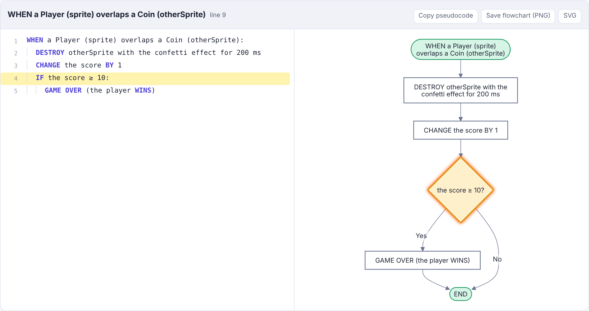

# Codeflow

Codeflow shows a MakeCode Arcade game as **plain-English pseudocode** and **flowcharts**.
It is built for students learning to read and explain code.



```
WHEN A Button Pressed:
    IF mySprite is hitting a wall on the Bottom:
        SET mySprite's y velocity TO -150
```

Each part of the game gets its own pseudocode and flowchart:

- **ON START**
- each event, e.g. **WHEN A Button Pressed** or **WHEN a Player overlaps an Enemy**
- each **FUNCTION**

Hover over a line of pseudocode to highlight it in the flowchart.

Flowcharts use the standard shapes:

| Shape | Meaning |
| --- | --- |
| Oval | Start / End |
| Rectangle | An action |
| Diamond | A decision (Yes / No) |
| Parallelogram | Input / Output (messages, speech, asking the player) |
| Double-sided box | Run a function / timer |

You can copy the pseudocode, save flowcharts as PNG or SVG, or print the whole page.

## Using it (students)

1. Open your game in MakeCode Arcade and click **JavaScript** at the top.
2. Select all the code (Ctrl+A) and copy it (Ctrl+C).
3. Open the Codeflow page, paste the code and click **Show pseudocode & flowcharts**.

Block projects work too, because MakeCode turns blocks into JavaScript.
Everything runs in the browser and nothing is uploaded.

## Blocks

Codeflow adds **no blocks** and does not change how a game runs. When the extension is added
to a project, a **Codeflow** toolbox category appears with one button,
**Show pseudocode & flowcharts**. The button opens Codeflow inside the editor, and Codeflow
reads the project's code (it never changes it).

## Putting the page online (GitHub Pages)

The web page lives in `docs/`. On GitHub go to **Settings → Pages**. Set **Source** to
*Deploy from a branch*, choose the branch and the `/docs` folder, then save.
The page will be at `https://anwhel.github.io/Codeflow/`.

A teacher can also link a shared project directly:
`https://anwhel.github.io/Codeflow/?share=https://makecode.com/_abc123`

## Inside the MakeCode editor (editor extension)

This repo is also a MakeCode extension (`pxt.json`, `main.ts`). When it is added to a
project, a **Codeflow** toolbox category gets a **Show pseudocode & flowcharts** button.
That button opens the page inside the editor, and the page reads the project's code with
the editor-extension `extusercode` message, so students skip the copy and paste.

**Limitation:** MakeCode only opens an extension's web page when the MakeCode team has
approved the GitHub repo **and** listed its URL in `approvedEditorExtensionUrls`.
Until then, adding the extension shows "Sorry, this extension is not allowed", so use
the web page instead. To ask for approval, open an issue at
https://github.com/microsoft/pxt-arcade.

## Development

```
npm install
npm test          # converts test/samples/*.ts and checks every flowchart is valid
npm run serve     # serves docs/ at http://localhost:8080
```

- `docs/codeflow.js` is the converter: TypeScript syntax tree → pseudocode lines + Mermaid
  flowcharts. It also works in Node.
  - To change the wording for an API call, edit the `CALLS` phrasebook.
  - To change event headings, edit the `EVENTS` phrasebook.
- `docs/app.js` is the page: pasting code, share links, rendering, hover links, export and
  editor-extension messaging.
- The libraries (TypeScript 5.4.5 and Mermaid 11.4.1) load from jsDelivr.
